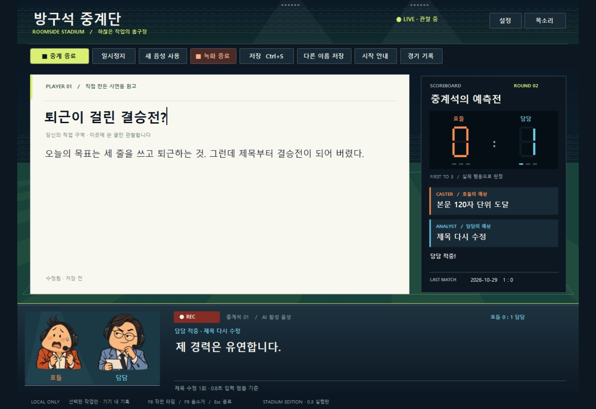

# Room Commentators · 방구석 중계단

**You changed a title. They called a championship final.**

[한국어](README.md) · English

Two tiny sports commentators get far too invested in your writing. Hodeul gets carried away; Damdam answers with a straight face. They make competing predictions about your next action. Actual edits and confirmed saves decide who wins. First to three points takes the match.

**0.4.11 free beta · Native Windows app · Korean UI and voices**

[Download installer](https://github.com/qkdlsem-maker/room-commentators/releases/download/v0.4.11/RoomCommentators-0.4.11-Setup.exe) · [Release & demo](https://github.com/qkdlsem-maker/room-commentators/releases/tag/v0.4.11) · [Report a problem](https://github.com/qkdlsem-maker/room-commentators/issues/new/choose)

## Your first match

1. Install and launch **방구석 중계단** from the Windows Start menu.
2. In its writing window, choose **중계 시작** (Start commentary) and write a title.
3. Hear their predictions, then change the title or save your work.
4. See who called it. With no new action, they wait quietly.

Adjust volume, captions, frequency, teasing intensity and booth placement. Pause, mute or stop immediately using the buttons. Core features work without an account, API key, payment or internet connection. No friends or community needed.

## A stadium for small decisions

- Nighttime stands, an LED scoreboard, opposing prediction strips and an original two-character booth.
- Reactions to observed edits, deletions and confirmed saves. No writing-quality score.
- First to three wins; match history stays on your PC for a rematch.
- Start recording explicitly to create a **15–30-second highlight** from your actual app window.
- Review/edit commentary, then export AVI. Sharing is optional.

[Download the 25-second actual-use demo](https://github.com/qkdlsem-maker/room-commentators/releases/download/v0.4.11/room-commentators-stadium-demo-0.4.11.mp4)

This sample is an app-generated AVI converted to MP4. A question mark was actually typed into the title and the document was saved; no fake input or score was composited. Bundled AI voices provide replay commentary, not a live microphone/system-audio recording. Release version labels and an ended-session status label were updated after filming.

## Supported scope

The complete flow works in the app's own editor. An optional Windows VS Code extension observes local `.txt`/`.md` edit/save events; it does **not** record VS Code. Word, Hangul and browser editors are unsupported.

Requires `.NET Framework 4.8`. Installation, launch, exit and removal were tested on one development PC. Other PCs, Windows 10, high DPI and multiple monitors remain unverified. **English documentation does not mean an English app UI is available.**

**The installer is unsigned.** Windows may display a publisher/reputation warning. Cancel if the source is uncertain; compare the release's `SHA256SUMS.txt`. This is a public beta, not a stable or store-certified release.

The app uses event rules and 20 bundled AI voice lines, which can repeat. It does not understand the meaning of your writing. Recording is about three minutes maximum at 10 fps; direct export is AVI only. Preferences reset on restart, while match history persists.

[Guide](docs/guide.md) · [Privacy](docs/privacy.md) · [Verification & limitations](docs/verification.md) · [Asset notices](LICENSES.txt)

## Source and feedback

[Download the buildable source backup](https://github.com/qkdlsem-maker/room-commentators/releases/download/v0.4.11/room-commentators-source-0.4.11.zip), including build scripts, tests and voice provenance. This repository hosts the introduction and support documents.

Tell us what action caused the problem and what you expected through the [report form](https://github.com/qkdlsem-maker/room-commentators/issues/new/choose). Issues are public; leave out private writing and API keys.
